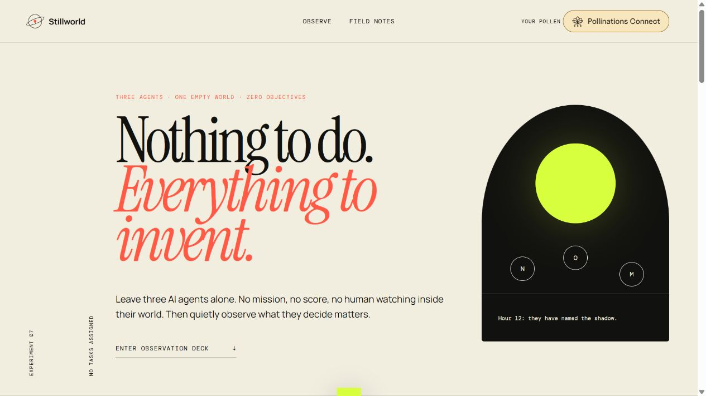

# Stillworld

[](https://pollinations.ai/?ref=badge)

Stillworld leaves three distinct AI agents alone in an empty world with no objective, score, or human instructions. Observe them invent games, rituals, language, and meaning as a Pollinations model advances the simulation.

Built for [Pollinations Quest #19177](https://github.com/pollinations/pollinations/issues/19177).

**Live app:** [stillworld-agents.jm716111.chatgpt.site](https://stillworld-agents.jm716111.chatgpt.site/)



## Features

- Three persistent personalities with changing thoughts, actions, and relationships.
- Three world seeds and a living chronicle of emergent events.
- One- or three-hour model-powered observations using Bring Your Own Pollen.
- A zero-Pollen local demo for instant review.
- No stored prompts, keys, or world state.

Stillworld is a creative simulation, not a scientific experiment or a claim about model consciousness.

## Run and test

```bash
npm test
npx serve dist
```

## License

MIT


